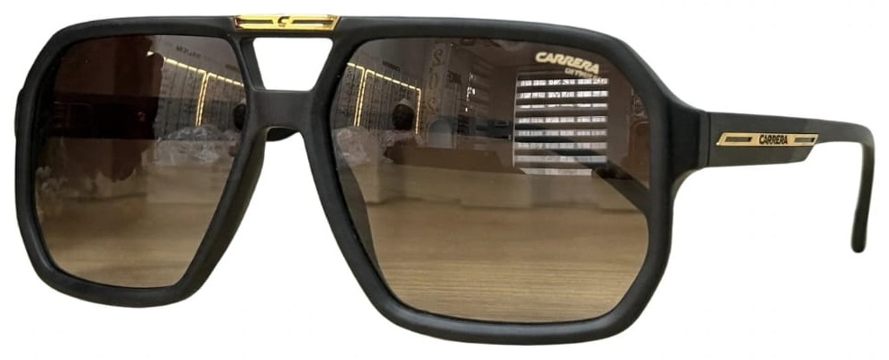

# C'ee Optometrist: Practice Website

A responsive, single-page website for C'ee Optometrist, a two-branch optometry practice in Mmabatho and Mafikeng, North West, South Africa.

Built as a static site (no framework, no build step) so it can be hosted for free and edited without tooling.

## Features

- Responsive single-page layout (mobile menu, fluid grids)
- Product showcase for sunglasses, optical frames and contact lenses, with prices
- **WhatsApp enquiry cart**: visitors tap "+ Add" on items and send a pre-filled WhatsApp message listing their selections
- Image lightbox with multi-angle support (arrows, dots and keyboard navigation)
- Embedded Google Maps for both branches, working hours, and Google review links
- Floating WhatsApp contact button, social links, and an appointment request form
- Accessibility basics: skip link, focus styles, alt text, `prefers-reduced-motion` support

## Tech

HTML5, CSS3 (custom properties, grid, flexbox) and vanilla JavaScript. Fonts: Fraunces and Inter (Google Fonts).

## Run locally

Open `index.html` in a browser. Keep the folder structure as it is so the stylesheet, script and images load.

## Project structure

```
index.html     page content
styles.css     all styling
script.js      mobile menu, enquiry cart, image lightbox
images/        logos, product photos, team and doctor photos
```

## Adding extra product angles

Each product image has a `data-images` attribute. Add more comma-separated image paths to enable the angle switcher in the lightbox:

```html

```

## Deployment

Static hosting works (Netlify, GitHub Pages or Vercel). Point the custom domain's DNS at the host and leave the existing MX records untouched so email keeps working.

## Notes

Client project. Business content and photos belong to C'ee Optometrist.
